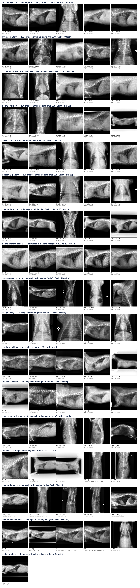

# 🩻 Vet X-Ray AI: Multi-Label Detection of Thoracic Findings in Dogs and Cats


Deep-learning study that detects radiographic findings, such as cardiomegaly, pleural effusion, pneumothorax and lung patterns, on **7,648 veterinary thoracic X-rays** (5,997 dogs, 1,651 cats).
It compares custom CNNs trained from scratch against five pretrained backbones and selects a model on validation data only. That model is evaluated once on held-out animals and exported with an inference script.



## 📊 Results (v1, held-out test animals)

| Model | Test macro PR-AUC (core findings) |
|---|---|
| **HieraDet-D Small** (selected on validation) | **0.492** (95 % CI 0.430–0.534) · macro ROC-AUC **0.874** |
| Custom residual CNN + SE (from scratch) | 0.347 |
| Custom VGG-style CNN (from scratch) | 0.328 |

Confidence intervals resample **animals**, not images, so several views of one animal are not counted as independent evidence.
The gap between the scratch CNNs and the pretrained backbone shows how much pretraining is worth at this data scale.

## 🔬 Method highlights

- **Dataset audit**: DICOM header scan, inclusion criteria, grouping of images that belong to the same animal, near-duplicate checks
- **Leak-free split**: animal-level, label-stratified 70 / 15 / 15 train / val / test; no animal crosses partitions
- **DICOM processing**: robust percentile windowing, MONOCHROME1 inversion, letterboxing to a square cache
- **Models**: custom VGG-style CNN, custom residual CNN with squeeze-and-excitation, then CLIP ViT-B/32, HieraDet-D Small, EfficientNet-B3, DenseNet-121 and ConvNeXt-Tiny
- **Training**: two-stage fine-tuning (head, then full network), early stopping, Optuna hyperparameter search
- **Selection protocol**: fixed before testing; per-finding thresholds are frozen from validation
- **Analysis**: subgroup results by species, scanner, view and image quality; prediction gallery and error analysis
- **Deployment check**: model export plus an inference-parity test between the notebook and the standalone script

## 🚧 v2 (in progress): study-aware fine-tuning

v2 keeps the same images and labels and fixes weaknesses found in v1:

- Labels of other views in a positive study are masked instead of being treated as negatives
- Evaluation and inference work **per study** (several views fused), not per single film
- Out-of-fold thresholds; outputs with too few positives are removed
- A gate model fixes polarity and rotation and rejects out-of-distribution inputs
- Stronger augmentation (JPEG, margins, annotations, photo look) and higher resolutions (512 and 768 px)

Early validation runs at 768 px reach a study-level macro AP of about 0.57. Final test numbers will be added when training is finished.

## 🗂️ Repository layout

```text
v1/
  xray_finetuning_kaggle.ipynb   # Full study: audit → training → selection → test → explainability
  petai_xray_inference.py        # Standalone inference for the selected model
v2/
  xray_finetuning_v2.py          # Study-aware training pipeline (SMOKE / FULL modes, resumable)
  xray_finetuning_v2_kaggle.ipynb
  petai_xray_inference_v2.py     # Study-level inference with input gate
  tests_inference.py             # Inference parity tests
  build_cache_768.py             # 768 px image cache builder
  gpu_watchdog.py, resume_training.ps1
figures/                         # Sample and pathology galleries
results/counts_per_finding.csv   # Label counts per split and species
```

Model weights, image caches and raw DICOMs are not included. Local paths at the top of the v2 scripts point to the author's machine; change them to your own data folders. On Kaggle they are detected automatically.

## 📚 Data and attribution

This work uses the **VetXRay** veterinary thoracic radiograph dataset ([Zenodo, DOI 10.5281/zenodo.19051776](https://zenodo.org/records/19051776)), released under **CC BY 4.0**.
The original authors are listed on the Zenodo record. The images in `figures/` are processed derivatives. The original authors do not endorse this work.

> ⚠️ This is a research project. It is **not** a medical device and must not be used for clinical decisions.
